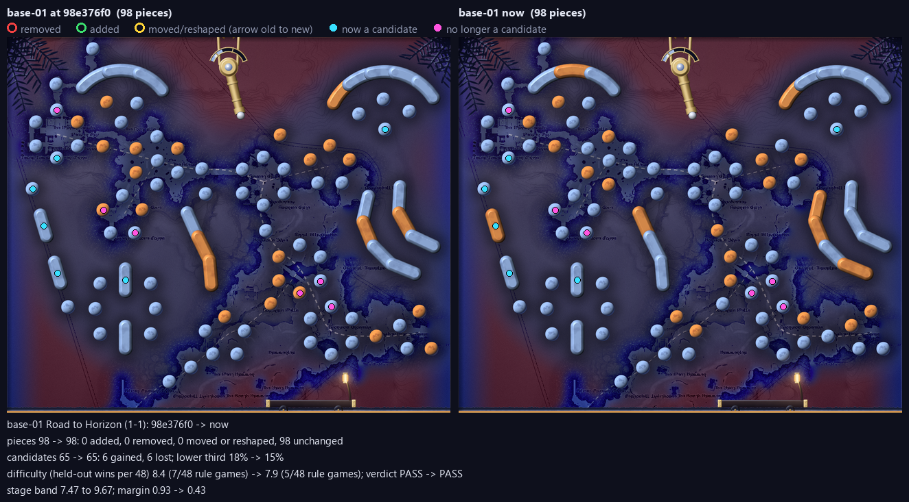
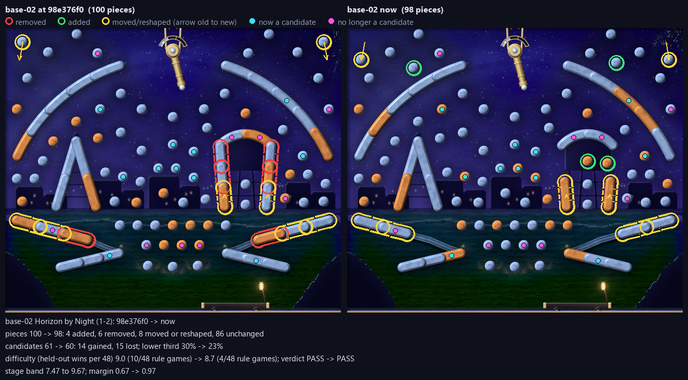
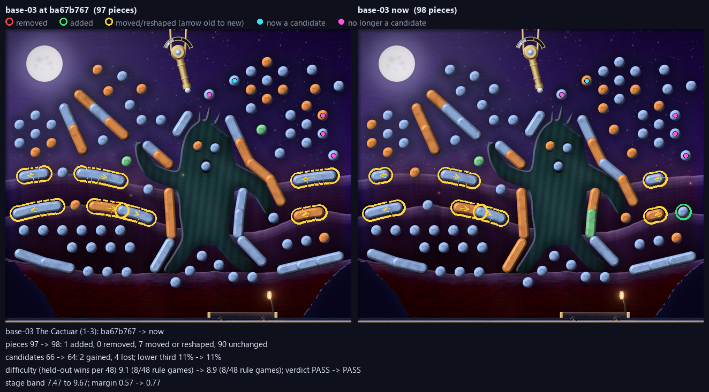
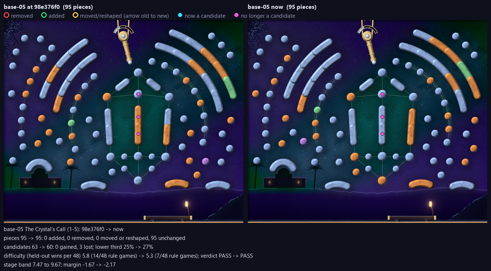

<!-- generated by mfl.py pack: delete this line to keep your edits -->
# Review pack: MR1

Made by `mfl.py pack --stage mr1` at 2026-10-10 06:05 from the working tree; diffs against 98e376f0. Reviewers: use these files only; never run a build.

## Files

| File | What it is |
|---|---|
| `sheet.png` | contact sheet: composites, engine renders, and each level's figures |
| `base-NN-composite.png` | the pipeline's 1x composite as committed |
| `base-NN-engine-1280.png`, `-640.png` | the plugin's own render (MoonfallRender `--moment start --cache`), what the game ships; it shows the converted runtime files, so check the `convert` column |
| `base-NN-diff.png` | before and after against the `--changed-since` revision (only for changed levels) |
| `base-NN-report.json` | the build report |
| `status.json` | the table below as data |

## Status

```
code id       verdict  build  pieces cand  low3 won/48  ramp margin convert  precheck changed since review
1-1  base-01  PASS     fresh      98   65   15%      5   7.9   +0.4 stale    WARN     never reviewed
1-2  base-02  PASS     fresh      98   60   23%      4   8.7   +1.0 stale    WARN     never reviewed
1-3  base-03  PASS     fresh      97   66   11%      8   9.1   +0.6 fresh    WARN     never reviewed
1-4  base-04  PASS     fresh     105   64    6%      8   8.3   +0.8 fresh    WARN     never reviewed
1-5  base-05  PASS     fresh      95   60   27%      7   5.3   -2.2 stale    WARN     never reviewed
```

## Changed since 98e376f0

### base-01



```
base-01 Road to Horizon (1-1): 98e376f0 -> now
pieces 98 -> 98: 0 added, 0 removed, 0 moved or reshaped, 98 unchanged
candidates 65 -> 65: 6 gained, 6 lost; lower third 18% -> 15%
difficulty (held-out wins per 48) 8.4 (7/48 rule games) -> 7.9 (5/48 rule games); verdict PASS -> PASS
stage band 7.47 to 9.67; margin 0.93 -> 0.43
```

### base-02



```
base-02 Horizon by Night (1-2): 98e376f0 -> now
pieces 100 -> 98: 4 added, 6 removed, 8 moved or reshaped, 86 unchanged
candidates 61 -> 60: 14 gained, 15 lost; lower third 30% -> 23%
difficulty (held-out wins per 48) 9.0 (10/48 rule games) -> 8.7 (4/48 rule games); verdict PASS -> PASS
stage band 7.47 to 9.67; margin 0.67 -> 0.97
```

### base-03



```
base-03 The Cactuar (1-3): 98e376f0 -> now
pieces 98 -> 97: 0 added, 1 removed, 2 moved or reshaped, 95 unchanged
candidates 62 -> 66: 5 gained, 1 lost; lower third 11% -> 11%
difficulty (held-out wins per 48) 8.8 (6/48 rule games) -> 9.1 (8/48 rule games); verdict PASS -> PASS
stage band 7.47 to 9.67; margin 0.87 -> 0.57
```

### base-05



```
base-05 The Crystal's Call (1-5): 98e376f0 -> now
pieces 95 -> 95: 0 added, 0 removed, 0 moved or reshaped, 95 unchanged
candidates 63 -> 60: 0 gained, 3 lost; lower third 25% -> 27%
difficulty (held-out wins per 48) 5.8 (14/48 rule games) -> 5.3 (7/48 rule games); verdict PASS -> PASS
stage band 7.47 to 9.67; margin -1.67 -> -2.17
```
