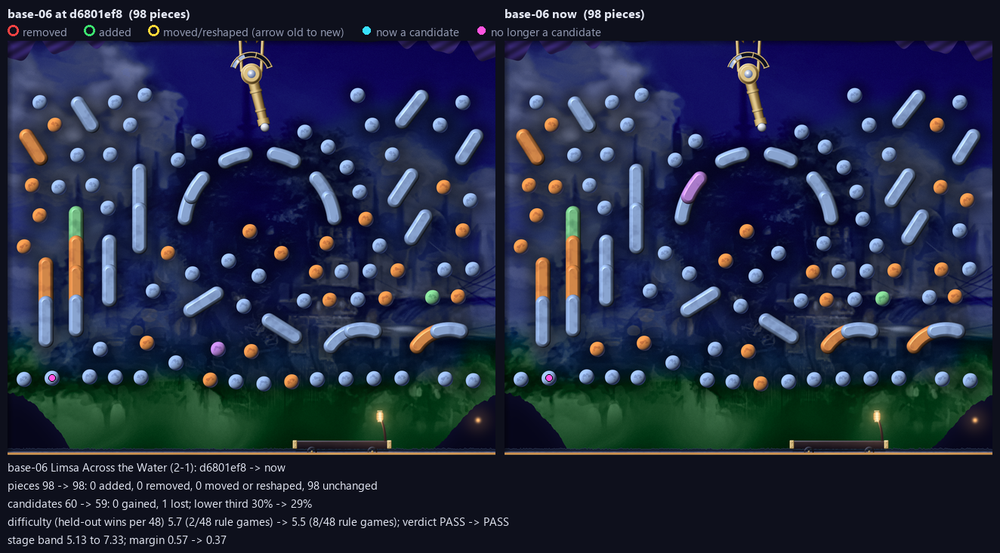
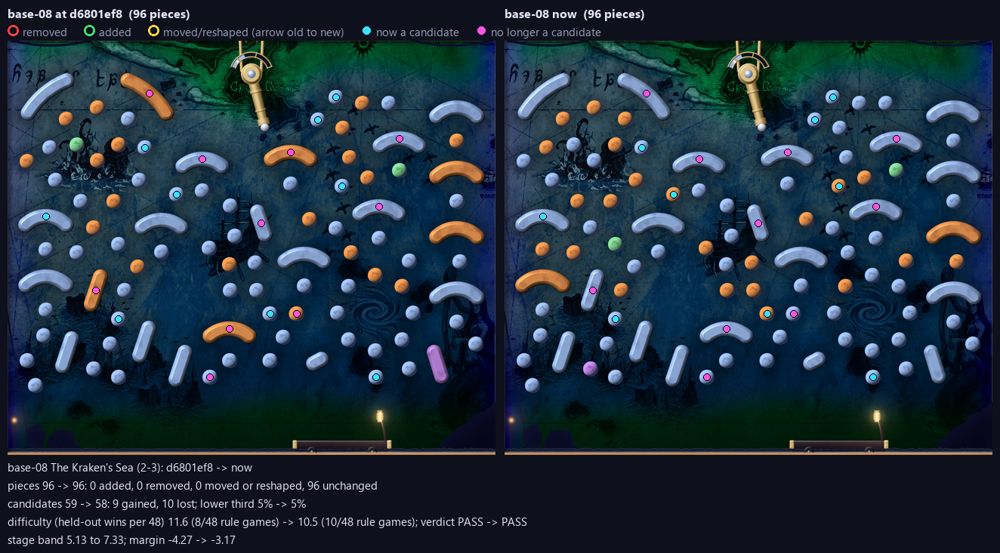
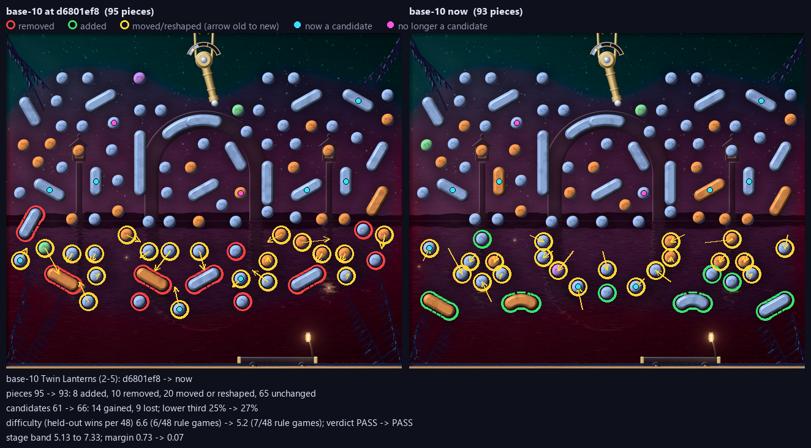

<!-- generated by mfl.py pack: delete this line to keep your edits -->
# Review pack: MR2

Made by `mfl.py pack --stage mr2` at 2026-10-22 01:39 from the working tree; diffs against d6801ef8. Reviewers: use these files only; never run a build.

## Files

| File | What it is |
|---|---|
| `sheet.png` | contact sheet: composites, engine renders, and each level's figures |
| `base-NN-composite.png` | the pipeline's 1x composite as committed |
| `base-NN-engine-1280.png`, `-640.png` | the plugin's own render (MoonfallRender `--moment start --cache`), what the game ships; it shows the converted runtime files, so check the `convert` column |
| `base-NN-diff.png` | before and after against the `--changed-since` revision (only for changed levels) |
| `base-NN-report.json` | the build report |
| `status.json` | the table below as data |

## Status

```
code id       verdict  build  pieces cand  low3 won/48  ramp margin convert  precheck changed since review
2-1  base-06  PASS     fresh      98   59   29%      8   5.5   +0.4 stale    FAIL     never reviewed
2-2  base-07  PASS     fresh     111   74   26%      6   6.2   +1.1 stale    FAIL     never reviewed
2-3  base-08  PASS     fresh      96   58    5%     10  10.5   -3.2 stale    FAIL     never reviewed
2-4  base-09  PASS     fresh     104   67   28%      7   7.0   +0.3 fresh    WARN     never reviewed
2-5  base-10  PASS     fresh      93   66   27%      7   5.2   +0.1 fresh    WARN     never reviewed
```

## Changed since d6801ef8

### base-06



```
base-06 Limsa Across the Water (2-1): d6801ef8 -> now
pieces 98 -> 98: 0 added, 0 removed, 0 moved or reshaped, 98 unchanged
candidates 60 -> 59: 0 gained, 1 lost; lower third 30% -> 29%
difficulty (held-out wins per 48) 5.7 (2/48 rule games) -> 5.5 (8/48 rule games); verdict PASS -> PASS
stage band 5.13 to 7.33; margin 0.57 -> 0.37
```

### base-08



```
base-08 The Kraken's Sea (2-3): d6801ef8 -> now
pieces 96 -> 96: 0 added, 0 removed, 0 moved or reshaped, 96 unchanged
candidates 59 -> 58: 9 gained, 10 lost; lower third 5% -> 5%
difficulty (held-out wins per 48) 11.6 (8/48 rule games) -> 10.5 (10/48 rule games); verdict PASS -> PASS
stage band 5.13 to 7.33; margin -4.27 -> -3.17
```

### base-10



```
base-10 Twin Lanterns (2-5): d6801ef8 -> now
pieces 95 -> 93: 8 added, 10 removed, 20 moved or reshaped, 65 unchanged
candidates 61 -> 66: 14 gained, 9 lost; lower third 25% -> 27%
difficulty (held-out wins per 48) 6.6 (6/48 rule games) -> 5.2 (7/48 rule games); verdict PASS -> PASS
stage band 5.13 to 7.33; margin 0.73 -> 0.07
```
