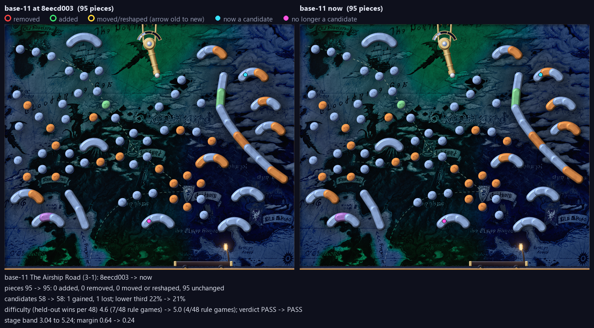
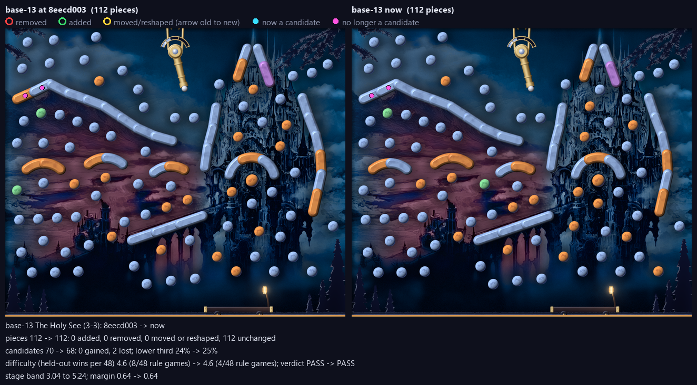
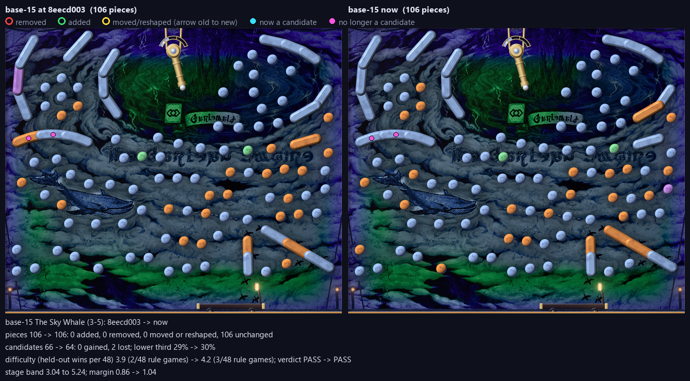

<!-- generated by mfl.py pack: delete this line to keep your edits -->
# Review pack: MR3

Made by `mfl.py pack --stage mr3` at 2026-10-22 07:02 from the working tree; diffs against 8eecd003. Reviewers: use these files only; never run a build.

## Files

| File | What it is |
|---|---|
| `sheet.png` | contact sheet: composites, engine renders, and each level's figures |
| `base-NN-composite.png` | the pipeline's 1x composite as committed |
| `base-NN-engine-1280.png`, `-640.png` | the plugin's own render (MoonfallRender `--moment start --cache`), what the game ships; it shows the converted runtime files, so check the `convert` column |
| `base-NN-diff.png` | before and after against the `--changed-since` revision (only for changed levels) |
| `base-NN-report.json` | the build report |
| `status.json` | the table below as data |

## Status

```
code id       verdict  build  pieces cand  low3 won/48  ramp margin convert  precheck changed since review
3-1  base-11  PASS     stale      95   58   21%      4   5.0   +0.2 stale    WARN     4 file(s): base-11.png, base-11.json, base-11.py, aldenard-airship-lane.json
3-2  base-12  PASS     fresh      96   61   28%      4   5.8   -0.6 stale    WARN     3 file(s): base-12.png, base-12.json, base-12.py
3-3  base-13  PASS     fresh     112   68   25%      4   4.6   +0.6 stale    WARN     3 file(s): base-13.png, base-13.json, base-13.py
3-4  base-14  PASS     fresh     119   75   15%      4   4.4   +0.8 stale    WARN     3 file(s): base-14.png, base-14.json, base-14.py
3-5  base-15  PASS     fresh     106   64   30%      3   4.2   +1.0 stale    WARN     4 file(s): base-15.png, base-15.json, base-15.py, sky-whale.json
```

## Changed since 8eecd003

### base-11



```
base-11 The Airship Road (3-1): 8eecd003 -> now
pieces 95 -> 95: 0 added, 0 removed, 0 moved or reshaped, 95 unchanged
candidates 58 -> 58: 1 gained, 1 lost; lower third 22% -> 21%
difficulty (held-out wins per 48) 4.6 (7/48 rule games) -> 5.0 (4/48 rule games); verdict PASS -> PASS
stage band 3.04 to 5.24; margin 0.64 -> 0.24
```

### base-13



```
base-13 The Holy See (3-3): 8eecd003 -> now
pieces 112 -> 112: 0 added, 0 removed, 0 moved or reshaped, 112 unchanged
candidates 70 -> 68: 0 gained, 2 lost; lower third 24% -> 25%
difficulty (held-out wins per 48) 4.6 (8/48 rule games) -> 4.6 (4/48 rule games); verdict PASS -> PASS
stage band 3.04 to 5.24; margin 0.64 -> 0.64
```

### base-15



```
base-15 The Sky Whale (3-5): 8eecd003 -> now
pieces 106 -> 106: 0 added, 0 removed, 0 moved or reshaped, 106 unchanged
candidates 66 -> 64: 0 gained, 2 lost; lower third 29% -> 30%
difficulty (held-out wins per 48) 3.9 (2/48 rule games) -> 4.2 (3/48 rule games); verdict PASS -> PASS
stage band 3.04 to 5.24; margin 0.86 -> 1.04
```
